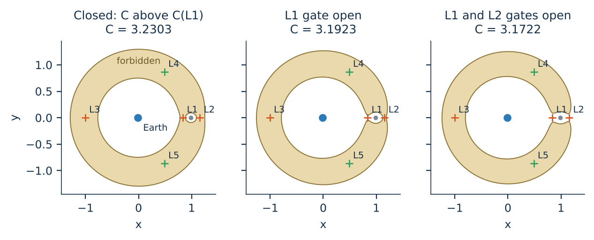
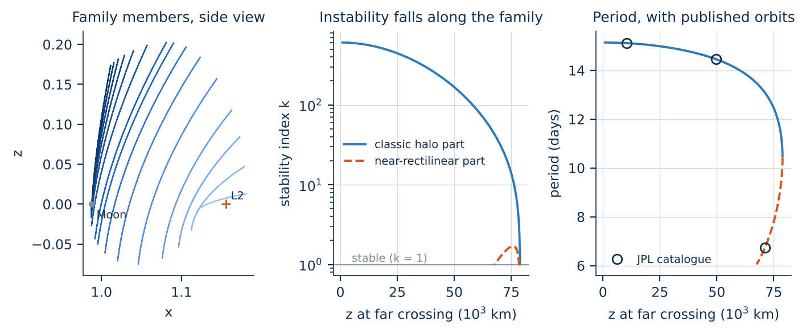
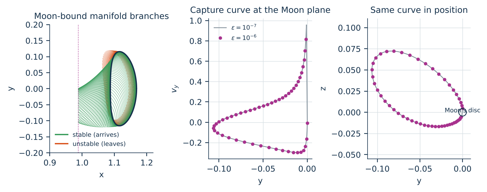
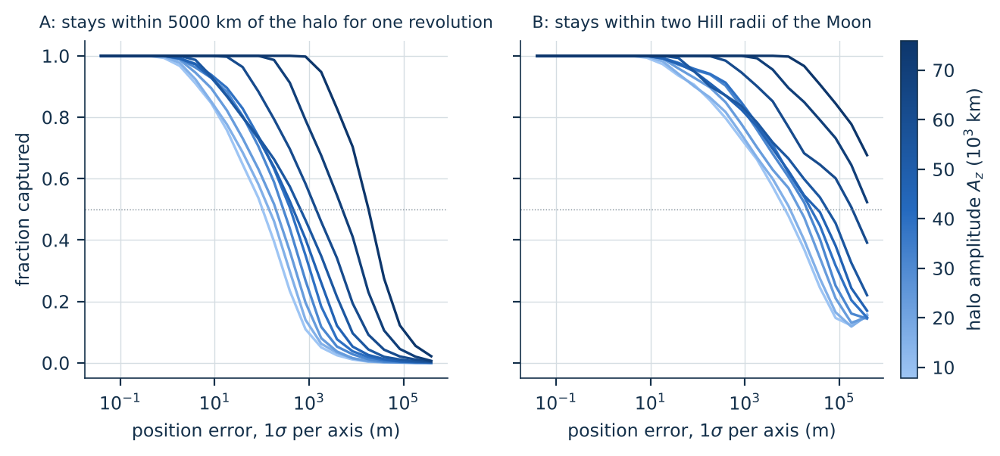
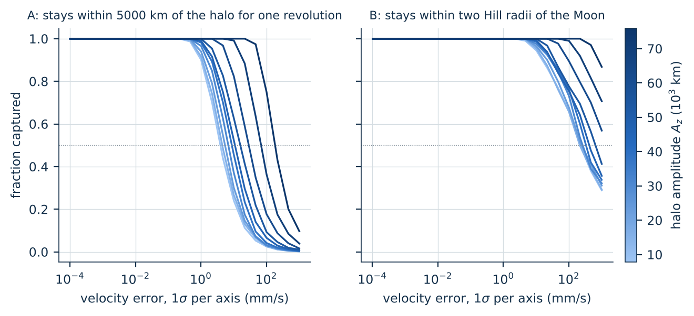
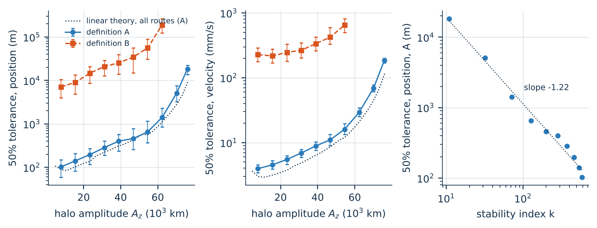
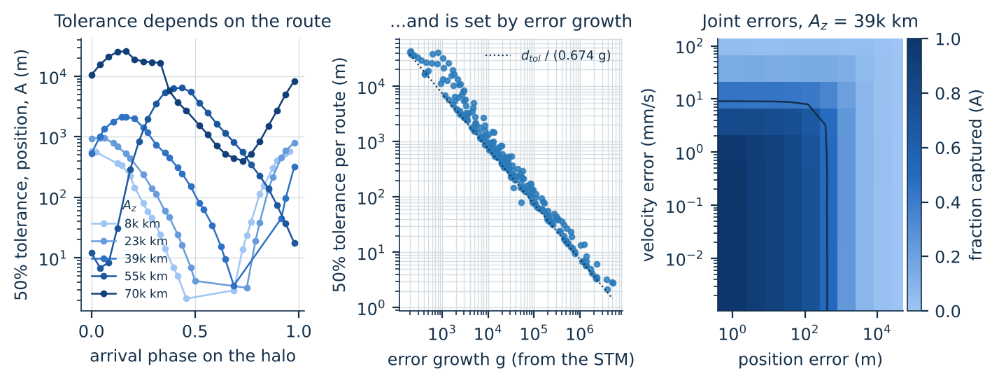
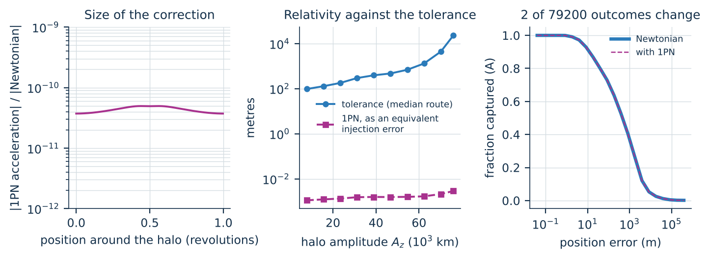

# The project in plain words

Written for a class 11-12 physics student. Each idea is explained in everyday terms first; the proper name is given at the end so you can still use the real vocabulary with a teacher or judge. `docs/HOW_IT_WORKS.md` is the fuller technical version, `docs/GLOSSARY.md` lists every term.

## 1. The question

A spacecraft wants to park in a loop near the far side of the Moon. There is a special path that carries it into that loop without firing the engine. But no launch is perfect. **How big a starting mistake can the spacecraft make and still arrive?** And does the answer change with the size of the loop?

Everything else in the project exists to answer that.

*Proper name: Research question.*

## 2. Turn with the Moon

The Moon circles the Earth about once every four weeks. If we watch from a viewpoint that turns at the same rate, the Earth and Moon both stand still and we get a fixed map to draw paths on.

The cost is the same as on a merry-go-round: two extra pushes appear. One throws everything outward (the *centrifugal* push, bigger the further out you are). One pushes anything that is moving sideways (the *Coriolis* push, bigger the faster you go). Add those two to the gravity of Earth and Moon and you have every force in the problem.

*Proper name: Rotating frame; circular restricted three-body problem (CR3BP).*

## 3. Five balance points

There are five spots where the pulls and the outward push cancel exactly. A spacecraft placed there at rest stays there. They are named L1 to L5, after Lagrange.

L1, L2 and L3 sit on the Earth–Moon line and behave like a ball balanced on top of a hill: the smallest miss grows. L4 and L5 behave like a ball in a bowl: a small miss just makes the spacecraft circle.

"Grows" has a precise meaning. Near L2 a miss multiplies by about 8.7 every 4.3 days. That is exponential growth, the same maths as compound interest, and it is the villain of the whole story.

*Proper name: Lagrange points; linear stability; eigenvalues.*

## 4. Energy draws the map

A ball thrown upward stops where its energy runs out. Here, too, a spacecraft with a given energy has places it can never reach. Draw those as land and the rest as water and you have a chart.

With low energy the Moon sits in a closed lake. Add energy and a channel opens at L1, joining the Earth's sea to the Moon's lake. Add more and a second channel opens at L2, leading out to open space. Mission designers choose the energy that opens exactly the channels they need.

The number that stays constant along any path is called the Jacobi constant, C. It runs backwards: bigger C means less energy.

*Proper name: Jacobi constant; Hill region; zero-velocity curve.*

## 5. Parking loops

Near L2 there are closed loops a spacecraft can fly round and round. Seen from Earth they look like a halo around the Moon, so they are called halo orbits. They come in a whole range of sizes, from about 8,000 km tall to about 76,000 km tall.

Each loop has an **instability number**, k. It says how fast a mistake grows: after one lap, a mistake has grown by about 2k. Small loops are wild (k near 600, so a mistake grows about 1,200 times per lap). Big loops are calmer (k near 11). The biggest ones, close to the Moon, are almost stable.

*Proper name: Halo orbit; orbit family; stability index; Floquet multiplier.*

## 6. Free rides

On a hilltop there is exactly one direction from which a ball can roll up and stop at the top. An unstable loop has the same thing: a tube of paths that glide onto it and settle, with no engine burn. That tube is the free ride in. There is a matching tube of free rides out.

Where the free-ride tube crosses the line through the Moon, it marks out a closed ring of starting conditions. Start on the ring and you arrive. That ring is the target your spacecraft has to hit.

*Proper name: Stable and unstable invariant manifolds; Poincaré section.*

## 7. The experiment

Take a loop. Pick 24 starting points on its target ring. At each one, add a random mistake of a chosen size, 150 times over. Let every spacecraft coast with no corrections and see what happens: it arrives, it drifts away, or it hits the Moon.

Repeat for 22 mistake sizes, from 4 centimetres to 390 kilometres, and for 10 loop sizes. That is 3.17 million flights. The mistake size at which exactly half arrive is called the **50% tolerance**. It is the single number that answers the question.

"Arrives" needs a rule, and the rule changes the answer, so two were used. Rule A: stay within 5,000 km of the loop for one whole lap. Rule B: just stay near the Moon for the same length of time.

*Proper name: Monte Carlo simulation; capture criterion; common random numbers.*

## 8. What came out

**Bigger loops forgive bigger mistakes.** Under rule A the 50% tolerance is about 100 m for the smallest loop and about 18 km for the largest. In speed, 4 mm/s to 185 mm/s.

**The route matters more than the loop.** For one and the same loop, some starting points tolerate a thousand times more error than others. The fragile ones pass close to the Moon.

**A simple rule predicts it all.** Work out how much a mistake grows along the route, call it g. The tolerance is the allowed 5,000 km divided by g. The simulation agrees with that across four powers of ten.

**Einstein's corrections do not matter here.** They change the force by 4 parts in 100 billion. Out of 3.17 million comparisons, 11 came out differently.

*Proper name: Scaling law; state transition matrix; first post-Newtonian correction.*

# Every graph explained

The figures are in `paper/figures/`.

## Figure 1: Where a spacecraft is allowed to go

**What the axes are.** Three maps seen from above. Both axes are distance, measured in Earth–Moon distances (1 = 389,703 km). Earth is the blue dot at the centre, the Moon the small grey dot on the right. The crosses are the five balance points.

**Look here first.** The brown ring. That is the no-go zone for a spacecraft with the energy written above each map. White is where it may travel.

**What it tells you.** Reading left to right, the energy increases (the number C goes down). Left: the Moon is walled in. Middle: a gap has opened at L1, so Earth and Moon are connected. Right: a second gap has opened at L2, so a spacecraft can leave past the Moon. The balance points are the gateways.

**Easy to misread.** C runs backwards: 3.2303 is the lowest energy of the three, 3.1722 the highest.

**Check yourself.** A spacecraft near the Moon has C = 3.19. Can it reach the Earth? Can it escape to deep space?

Answer
It can reach the Earth, because C is below the L1 value so that gate is open (middle map). It cannot escape, because C is still above the L2 value, so the outer gate is shut.

## Figure 2: The family of parking loops

**What the axes are.** Left: a side view. Across is distance along the Earth–Moon line, up is height above the plane the Moon orbits in. Middle: across is loop size (thousands of km), up is the instability number k on a scale where each gridline is ten times the one below. Right: across is loop size, up is the time for one lap, in days.

**Look here first.** The left panel. Each curved line is one loop seen edge-on. Light blue are small loops near L2; dark blue are large ones that reach up and lean towards the Moon.

**What it tells you.** Middle: instability falls steadily as the loops get bigger, from about 600 to about 1. That one curve is why big loops forgive bigger mistakes. Right: a lap takes about 15 days for small loops and shortens for large ones. The three circles are values published by NASA's Jet Propulsion Laboratory. They sit exactly on the curve this code calculated, which is the main evidence that the code is right.

**Easy to misread.** The orange dashed parts are a second branch of the family (the near-rectilinear orbits). The experiment used only the blue branch.

**Check yourself.** By what factor does a mistake grow in one lap of a loop with k = 300?

Answer
About 2k = 600 times.

## Figure 3: The free rides, and the target they make

**What the axes are.** Left: a map from above near the Moon. Middle and right: these are not maps of space. Each dot is one free-ride path at the instant it crosses the line through the Moon. Middle shows its sideways position (across) against its sideways speed (up). Right shows sideways position against height, with the Moon's outline drawn for scale.

**Look here first.** The left panel. Green paths flow into the dark loop, orange paths flow out. The dotted vertical line passes through the Moon; that is where the experiment starts its spacecraft.

**What it tells you.** The dots form a closed ring. To get a free ride you must cross the Moon's line with a position and speed that lie on that ring. The grey line under the dots is the same calculation repeated with a ten-times smaller step. It lands in the same place, which shows the ring is real and not an accident of how it was computed.

**Easy to misread.** The right panel shows the paths pass only a few thousand kilometres from the Moon's surface. That closeness is what makes some routes so sensitive.

**Check yourself.** Why is the target a ring and not a single point?

Answer
Because the loop is a whole circle of positions, and from each one a different free-ride path leads back. One path per point of the loop gives a ring of paths.

## Figure 4: How many arrive, for each size of position mistake

**What the axes are.** Across: the size of the starting position mistake in metres. The scale multiplies by 100 at each gridline: 0.1 m, 10 m, 1 km, 100 km. Up: the fraction of spacecraft that arrived, from 0 (none) to 1 (all). Each curve is one loop size; the colour bar on the right says which (light = small, dark = large).

**Look here first.** Any one curve on the left panel. It starts at 1 (tiny mistakes, everyone arrives), then slides down to 0 (big mistakes, nobody arrives). Where it crosses the dotted line at 0.5 is that loop's 50% tolerance.

**What it tells you.** The darker the curve, the further right it sits: bigger loops tolerate bigger mistakes. Reading off the crossings gives about 100 m for the lightest curve and about 18 km for the darkest. The right panel uses the looser rule B (just stay near the Moon). Its curves sit roughly a hundred times further right.

**Easy to misread.** On the right panel the curves never reach zero. Even with a huge mistake some spacecraft happen to linger near the Moon, and rule B counts them. That is a weakness of rule B, not good news.

**Check yourself.** On the left panel, a curve reads 0.8 at 100 m. What does that mean in words?

Answer
With a typical position mistake of 100 m, 80% of the spacecraft still arrived and held the loop for a lap.

## Figure 5: The same, for mistakes in speed

**What the axes are.** Exactly as the previous figure, except across is now the starting speed mistake in millimetres per second. Position is perfect; only the speed is wrong.

**Look here first.** Where the lightest and darkest curves cross 0.5 on the left panel.

**What it tells you.** The 50% tolerance runs from about 4 mm/s for the smallest loop to about 185 mm/s for the largest. For comparison, the spacecraft is travelling at roughly 200 metres per second, so 4 mm/s is about two parts in a hundred thousand.

**Easy to misread.** These curves are steeper and more orderly than the position ones. Speed mistakes behave more simply, which shows up again in Figure 6.

**Check yourself.** Which is the stricter demand for the smallest loop: 100 m in position or 4 mm/s in speed?

Answer
They are the same demand seen two ways: each one alone gives a 50% chance. Figure 7 shows that having both at once is only slightly worse than having the larger one.

## Figure 6: The answer to the research question

**What the axes are.** Left and middle: across is loop size in thousands of km; up is the 50% tolerance (metres on the left, mm/s in the middle), on a scale that multiplies by 10 per gridline. Right: across is the instability number k, up is the tolerance, both on multiply-by-10 scales.

**Look here first.** The blue line with dots on the left panel. Each dot is one loop; it is the crossing point you read off Figure 4.

**What it tells you.** Tolerance climbs with loop size, gently at first and then steeply. Orange is rule B, always far above blue. The vertical bars show the uncertainty of each dot. The dotted line is the simple prediction (5,000 km divided by error growth); it follows the dots closely. Right panel: plotted against instability the dots fall on a straight line, which on these scales means a power law. The slope is −1.22: halve the instability and the tolerance rises about 2.3 times.

**Easy to misread.** Orange dots are missing for the largest loops. Under rule B more than half were still counted as arriving even at the largest mistake tested, so no 50% point exists to plot.

**Check yourself.** Why does a straight line on the right panel mean a power law?

Answer
Both axes are logarithmic. A straight line there means log(tolerance) = a + b·log(k), which is the same as tolerance = constant × k to the power b. Here b = −1.22.

## Figure 7: The route matters more than the loop

**What the axes are.** Left: across is where on the loop the free ride arrives (0 to 1 is once round the loop); up is that route's 50% tolerance in metres. Middle: across is the error-growth factor g of a route; up is its tolerance; every route of every loop is one dot. Right: a grid. Across is position mistake, up is speed mistake, and the shade shows the fraction that arrived (dark = most).

**Look here first.** The left panel. Follow one line and see how far it swings: from about 2 m to over 1 km for the same loop.

**What it tells you.** Choosing a good route is worth far more than choosing a different loop. The middle panel explains why: tolerance falls in a straight line as g rises, exactly as the rule tolerance = 5,000 km ÷ (0.674 × g) predicts (dotted). g is calculated without any random trials, so the cheap calculation predicts the expensive experiment. Right panel: the black 50% line is a square corner. Either mistake alone is enough to fail; having both is barely worse.

**Easy to misread.** g ranges from 200 to 5 million. The routes with huge g pass close to the Moon, where a small mistake is turned into a large change of direction.

**Check yourself.** A route has g = 1,000,000. Roughly what is its 50% tolerance?

Answer
5,000 km ÷ (0.674 × 1,000,000) ≈ 0.0074 km, which is about 7 metres.

## Figure 8: Does Einstein change the answer?

**What the axes are.** Left: across is position around the loop (one lap); up is the size of the relativistic correction to the force divided by the ordinary gravitational force. Middle: across is loop size; up is metres, multiply-by-100 per gridline. Right: the capture curve from Figure 4 for one loop, drawn twice.

**Look here first.** The left panel's vertical scale. The line sits at about 4 × 10⁻¹¹: four parts in a hundred billion.

**What it tells you.** Middle: blue is the tolerance (hundreds of metres to kilometres). Magenta is how big a starting mistake you would need to imitate the effect of relativity: a few millimetres. The gap is about a hundred thousand times. Right: the curve with relativity (dashed) lies exactly on the curve without it. The title counts how many individual outcomes changed.

**Easy to misread.** Relativity does shift the path, by tens of metres after one lap. That is the loop's own instability magnifying a tiny push. A real mission would include relativity when planning, and the shift would vanish.

**Check yourself.** Why is it still worth reporting a result that says 'no effect'?

Answer
Because it was a real question with a measurable answer, and the answer sets a limit: relativity cannot matter for this problem until tolerances shrink to millimetres. A null result that is quantified is a result.

